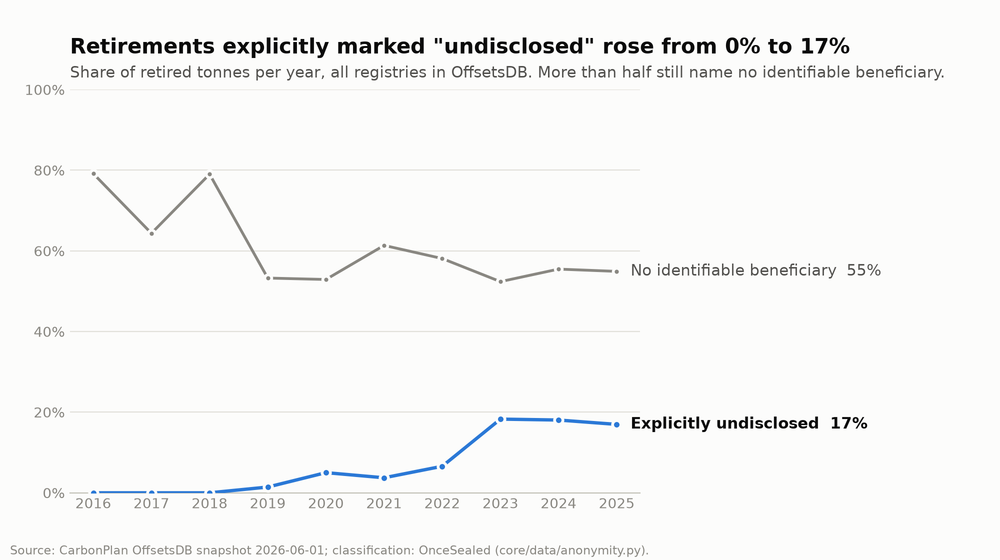

# OnceSealed

**Confidential but auditable carbon credit retirement, with evidence-backed quality signals.**

Built for the IEEE ClimateChain Global Hackathon 2026, track *Improve trust, transparency, and efficiency in carbon
markets*: smart contracts that prevent double counting, and verification of carbon credit quality.

OnceSealed is a prototype verification and privacy layer that could sit on top of existing carbon registries:

- **Once:** every credit can be retired only once. A smart contract rejects any serial range that overlaps an
  earlier retirement.
- **Sealed:** the buyer's identity is never written on-chain. Only a salted commitment is public; an authorized
  auditor opens an encrypted vault and records on-chain whether it matches.
- **Evidence-backed quality:** project documents are checked against ICVCM Core Carbon Principles. Every AI finding
  quotes the document verbatim, and code finds each quote in the PDF before it counts.

> **What is real and what is simulated.** Project data, issuance quantities and retirement histories are real
> (CarbonPlan OffsetsDB, Verra documents). Serial numbers are simulated (labelled `SIM-...`), buyers are fictional
> companies, and no real credit is retired: real retirements happen in registries such as Verra. The contract runs
> on the Sepolia test network.

**Live on Sepolia:** [`0xBb88057576b92Ef27753A6b2a4Df83bE444F1308`](https://sepolia.etherscan.io/address/0xBb88057576b92Ef27753A6b2a4Df83bE444F1308#code)
(source verified on Etherscan). It holds 11 anchored quality reports (15 versions), four issuance batches and one audited purchase
of 2,000 t retired as two lots; every transaction is listed in [`deployments/11155111-seed.json`](deployments/11155111-seed.json).

---

## The problem

Companies increasingly hide who retires carbon credits ("greenhushing"), while the market needs proof that each
credit was retired once and that quality claims rest on evidence.

Our analysis of all 495,403 retirement records (1.59 billion tonnes, 7 registries) in CarbonPlan's OffsetsDB
snapshot of 2026-06-01 ([method and tables](docs/anonymity_stats.md)):

- Retired tonnes **explicitly marked "not disclosed", "not public", "anonymous" or "private offset" rose from 0.4%
  (up to 2018) to 17.2% (2023-2026)**. This is a conservative lower bound for deliberate anonymity.
- In 2023-2026, **52.9-55.5%** of retired tonnes name no identifiable beneficiary at all. Part of this reflects how
  registries publish data, not only buyer choice.



Buyers want confidentiality; auditors and the public want proof. Today a buyer gets one or the other.

## How it works

### 1. Each credit retired once

The operator (the registry's role) registers an **issuance batch** with its serial range and a **lot size**, then
records retirements as serial ranges. The contract [`RetirementRegistry`](contracts/src/RetirementRegistry.sol)
rejects any range that overlaps an earlier one (`AlreadyRetired`). There is no transfer or mint function: retired
credits never become tradable tokens (Verra [prohibited](https://verra.org/verra-bans-greenwashing-cryptos-using-retired-credits/)
tokenizing retired credits in 2022).

### 2. Buyer sealed, auditor can check

1. A purchase is split into **standard lots** (1,000 t in the demo). In a lot batch the contract accepts only exactly
   one aligned lot per retirement (`NotALot` otherwise), so retired amounts look alike on-chain.
2. For each lot the operator writes a commitment
   `keccak256(abi.encode(buyerId, salt, batchId, start, end))` with a fresh 32-byte salt and
   `buyerId = keccak256("LEI:" + LEI)` ([LEI](https://www.gleif.org/) = legal entity identifier). Different salts
   mean the lots of one purchase cannot be linked through their commitments.
3. `{range, LEI, buyerId, salt}` is encrypted to the auditor's public key (libsodium sealed box) and kept off-chain;
   only `keccak256(ciphertext)` goes on-chain.
4. The auditor decrypts, runs six checks (vault hash, decryption, range, LEI validity, LEI to buyerId, commitment)
   and records `Verified` or `Rejected` on-chain, once and for good.
5. The buyer receives a receipt with the salts. Sharing it is selective disclosure: anyone can check it against the
   chain with the `verifyClaim` view. Because the commitment includes the range, a salt proves exactly one retirement.

This is a hash commitment plus encryption design, **not** a zero-knowledge proof system. Privacy is against the
public, not against the registry, which already knows its account holders.

### 3. Quality signal in three layers

| Layer | What it does | AI? |
|---|---|---|
| **Methodology status** | Looks up the ICVCM decision on the project's methodology in a sourced, versioned table ([`methodology_status.json`](core/ai/methodology_status.json)). | No |
| **Evidence extraction** | An LLM (`deepseek/deepseek-v4.1-flash` via OpenRouter) reads paragraphs selected by keyword scoring (up to 30,000 characters per principle) and returns verbatim quotes. Code finds every quote in the PDF text; quotes it cannot find are dropped. | Yes |
| **Evidence judgement** | A decision model (TypeSafe **Jev 1.13**, a third-party model via OpenRouter) rates the verified evidence on closed questions with probabilities. It sits behind a swappable interface so other models can be compared on the same questions. | Yes |
| **Data checks** | Reads the document's tables of yearly net emission reductions and compares them with the credits actually issued (OffsetsDB); checks that retirements never exceed issuance, that the methodology matches the registry listing, and whether a similarly named project issued credits for the same years elsewhere; and states which documents were read and which were not ([`docs/data_checks.md`](docs/data_checks.md)). | No |

Five of ICVCM's ten principles can be evidenced in a project document and are scored: additionality, permanence,
robust quantification, no double counting, social and environmental safeguards. The report is published as JSON in
[`reports/`](reports/); its `keccak256` over canonical JSON and a `method_hash` (models, prompt and question set
versions) are anchored on-chain, so anyone can re-hash the published file and compare.

> **Signal, not verdict.** A score says how well the submitted document evidences a principle. It is not an ICVCM
> assessment, a rating of the project, or a statement about its climate impact.

Reports for all 11 evaluation projects (overall signal, then the five principle scores: additionality, permanence,
quantification, double counting, safeguards; `-` = not applicable):

| Project | Methodology, ICVCM status | Overall | A | P | Q | D | S |
|---|---|---|---|---|---|---|---|
| [VCS673](reports/VCS673.json) Kibale forest rehabilitation, Uganda | AR-ACM0001 v5: no CCP approval (successor VM0047 approved) | 65 | 44 | 84 | 84 | 33 | 74 |
| [VCS985](reports/VCS985.json) Cordillera Azul REDD+, Peru | VM0007 v1.3: not CCP-approved (successor VM0048 approved) | 64 | 57 | 65 | 82 | 36 | 71 |
| [VCS1851](reports/VCS1851.json) grid-connected solar, India | ACM0002 v19: not approved (additionality) | 62 | 59 | - | 75 | 61 | 49 |
| [VCS2609](reports/VCS2609.json) Kuamut forest protection, Malaysia | VM0010 v1.4: under ICVCM assessment | 61 | 52 | 65 | 78 | 36 | 69 |
| [VCS4150](reports/VCS4150.json) DelAgua cookstoves, Rwanda | VM0050 v1.0: approved with conditions | 60 | 36 | - | 92 | 46 | 63 |
| [VCS1477](reports/VCS1477.json) Katingan peatland REDD+, Indonesia | VM0007 v1.5: not CCP-approved (successor VM0048 approved) | 60 | 57 | 80 | 78 | 34 | 37 |
| [VCS2846](reports/VCS2846.json) manure biodigesters, China | ACM0010 v8: no ICVCM decision found | 58 | 64 | - | 60 | 37 | 67 |
| [VCS138](reports/VCS138.json) landfill gas, USA | ACM0001 v16: approved with conditions | 56 | 43 | - | 66 | 62 | 54 |
| [VCS2505](reports/VCS2505.json) cookstoves, South Africa | VMR0006: not CCP-approved (successor VM0050 approved) | 55 | 40 | - | 87 | 40 | 42 |
| [VCS1742](reports/VCS1742.json) hydropower, India | ACM0002 v12.1: not approved (additionality) | 54 | 89 | - | 54 | 0 | 52 |
| [VCS1728](reports/VCS1728.json) onshore wind, India | ACM0002 v17: not approved (additionality) | 52 | 54 | - | 61 | 36 | 50 |

How to read this, honestly:

- **Read the principle scores, not the overall.** The overall signal of 11 very different projects falls between 52
  and 65, while principle scores range from 0 to 92. Averaging hides most of the information.
- **Document evidence is not methodology soundness.** The hydropower project scores 89 on additionality because its
  document contains a detailed investment analysis, yet ICVCM rejected the methodology's additionality test. That is
  why layer 1 is shown separately.
- **A well-written document can still be contested.** Cordillera Azul (VCS985) is among the highest signals here,
  while BeZero downgraded its rating in 2024 over its baseline deforestation rate. The tool checks whether evidence is
  *present* in the document; it cannot tell whether a baseline is inflated. External ratings are the right
  complement. The data checks give a first quantitative lead on this case: credits issued for 2009-2018 are **1.72×**
  the project description's own yearly figures (table on page 133). That alone does not prove over-crediting (the
  monitoring and verification reports, not read yet, explain issued volumes), but no reading of the text surfaces it.

All 11 reports share one `method_hash`; anchoring them on Sepolia added a second on-chain version for the four
reports first published on 2026-10-13 (re-run with the updated methodology table; scores moved by 1-2 points,
the decision model's known run-to-run variation).

## What we measured

| Claim | Result | Source |
|---|---|---|
| No serial is retired twice | 46 Foundry tests, including fuzz tests over thousands of random ranges, lots and (malicious) hints; 69 Python tests including end-to-end runs on a local chain | `contracts/test/`, `tests/` |
| Retirement cost does not grow with history | Replaying all **38,382 real retirements** of VCS766 vintage 2009: a first version that scanned past retirements added ~4,800 gas per retirement and passed 36M gas at retirement **7,467**; the sorted list stays at **~211k gas** for all 38,382 (a lot retirement costs ~204k) | [summary](data/derived/scale/summary.json), [chart](docs/figures/scale_gas.png), `scripts/scale_replay.py` |
| Lookups stay cheap | The contract's list-walking views cost ~4,400 gas per retirement (22M per call at 5,000, past the usual 50M `eth_call` cap at ~11,000), so clients use an index built from `CreditRetired` events: 1.5 s to build for 5,000 retirements, ~1 ms per lookup. Lot batches are answered by the contract in constant time | `scripts/index_benchmark.py` |
| Real network cost (Sepolia, current gas schedule) | Deploy 15.66M gas; retire one lot 1.02M (first in a batch) / 0.83M; anchor a report 463k; register a batch 243k; attest 33k. Storage writes cost far more than on the local chain; at Sepolia's ~0.001 gwei gas price, two deployments and all demo transactions cost 0.00078 test ETH in total | [`deployments/11155111-seed.json`](deployments/11155111-seed.json) |
| Public data has inconsistencies a contract would flag | In OffsetsDB, 11 project-vintages record more retirements than issuance (235,932 t). Replayed through the contract, 76 of 1,100 retirements are rejected. These are most likely data errors (vintage attribution, reissuance), **not proven double counting** | [`over_retirement.json`](data/derived/over_retirement.json), `scripts/over_retirement_replay.py` |
| How much does on-chain metadata reveal? | Project + quantity single out one retirement for **88.7%** of retired tonnes. With standard lots and the operator publishing lots once per period, 36.8% (daily) to 14.5% (quarterly) of tonnes still have no other purchase to hide among | [threat model T12](docs/threat_model.md), `scripts/linkability_stats.py` |
| Document figures vs registry records | Yearly net-reduction tables read for 9 of 11 projects (the parser finds none it can use in the other 2); 8 overlap issued vintages. Credits issued exceed the document's own figures by more than 20% over the covered years for 1 project (VCS985, 1.72×); 4 more have single vintages above it. 1 project retires more than was issued (VCS673, vintage 2017, +13,052 t); 1 shares its name and an issued vintage with another listing (VCS4150 / VCS2749, both DelAgua, Rwanda). Each flag is a lead, not a finding. Every project so far has only its project description read | [`docs/data_checks.md`](docs/data_checks.md), [`checks/`](checks/), `scripts/run_checks.py` |
| AI quotes are real | 179 of 179 quotes in the 11 published reports were found in the PDFs; 0 dropped | [`reports/`](reports/) |
| AI consistency, speed, cost (no labels needed) | On 177 yes/no questions over 48 excerpts from 11 projects, same answer in 3 runs: Jev 99.4%, LLM 96.0%, Turnike-JEV-4B 100% (both FP8 and BF16). Median time per excerpt: 0.8 s, 4.9 s, and 0.65 s for Turnike FP8 on a laptop RTX 4060 under WSL2 or 0.32 s for Turnike BF16 on a Colab L4 (both without its optional fast kernels; the API models include network time). Cost per 1,000 excerpts: $0.04, $0.79, $0 (local). FP8 and BF16 Turnike give the same yes/no answer on 176 of 177 questions (mean probability difference 0.014) | [`docs/ai_evaluation.md`](docs/ai_evaluation.md), `scripts/run_turnike.py` |
| **AI accuracy** | **Not measured yet.** Two team members label the same 177 questions independently; precision, recall, F1, Cohen's kappa and Brier score are computed by `scripts/eval_metrics.py` when the labels are in | [evaluation plan](docs/evaluation_plan.md) (Turkish) |
| Security | Slither: no findings beyond two documented false positives and one informational note; admin handover is two-step with a two-day delay; 13 threats analysed | [threat model](docs/threat_model.md) |

Consistency is not accuracy: a model can repeat the same wrong answer. Until the labels are in, we make no claim
about how often the AI is right.

## Trust assumptions and limitations

- **Prototype, simulated serials, fictional buyers.** No integration with a real registry.
- **The operator knows the buyer.** Privacy is against the public. A dishonest operator who seals one buyer in the
  vault but commits to another is caught by the auditor (tested); an operator who records a false buyer consistently
  in both is not, so the design relies on the registry's own customer checks (KYC).
- **One auditor, demo key handling.** All role keys live on one machine for the demo. Several auditors, key escrow
  and rotation are future work ([threat model](docs/threat_model.md), T10-T11).
- **Privacy needs a crowd.** Lots hide amounts, but if a project has a single buyer in a period, the project and time
  still point to that buyer. Batched publication is an operating rule the contract cannot enforce. Amounts that are
  not whole lots cannot be retired privately in a lot batch.
- **Only project descriptions have been read.** None of the 11 projects has its validation, monitoring or
  verification reports in the assessment yet, and that is where most monitored evidence sits; reports and data
  checks say so per project. `scripts/add_document.py` registers further documents.
- **AI signals depend on the excerpt.** Paragraphs are chosen by keywords from documents of hundreds of pages, so
  evidence outside the selection is missed. The overall score barely separates projects (52-65 across 11). The
  methodology table covers only the methodologies of the 11 evaluation projects.
- **Gas figures differ by network.** Scale experiments ran on a local Anvil chain; Sepolia's current schedule makes
  storage writes several times more expensive. The deployment uses 15.66M gas, close to the per-transaction limit of
  newer Ethereum versions, so the contract cannot grow much further without being split.

## Repository layout

```
contracts/      Foundry project: RetirementRegistry + tests (OpenZeppelin as a git submodule)
core/chain/     web3.py client (simulate before sending, event index), deployment records, committed ABI
core/privacy/   LEI identities, commitments, sealed-box audit vault, receipts
core/ai/        PDF extraction, quote verification, LLM client, decision model, report builder, checklist
core/data/      OffsetsDB loading, anonymity classes, simulated issuance batches
core/service.py end-to-end flows: anchor a report, retire lots, audit, verify a receipt
api/            FastAPI layer (public reads; operator and auditor actions need a role token)
web/            Next.js front end: project reports, retire, verify (reads Sepolia in the browser), audit
scripts/        demo, deployment, report generation and every measurement in the table above
tests/          pytest suite + vectors.json shared with the Foundry tests
reports/        published quality reports
checks/         published data checks (deterministic): document figures vs registry records
data/           simulated batches, demo buyers, evaluation set, derived measurements
deployments/    Sepolia deployment record and demo transactions
docs/           threat model, anonymity statistics, AI evaluation, figures
samples/        manifest of project documents (URLs + SHA-256); PDFs are downloaded manually
```

## Quick start

Requirements: Python 3.11+ (tested on 3.14) and [Foundry](https://getfoundry.sh) (the end-to-end tests and the demo
start a throwaway local chain with Foundry's `anvil`). No API key and no `.env` are needed for the following:

```bash
git clone --recurse-submodules https://github.com/lsaliherenl/OnceSealed
cd OnceSealed
python -m venv .venv
.venv/Scripts/activate          # Windows; use `source .venv/bin/activate` on macOS/Linux
python -m pip install -r requirements.txt
python -m pip install -e . --no-deps
python -m pytest -q             # 69 tests
python scripts/demo_e2e.py      # full story on a local chain: lots retired, overlap and partial lot rejected,
                                # auditor attests, receipt verified, forged receipts fail
(cd contracts && forge test)    # 46 contract tests
```

With a `.env` (copy [`.env.example`](.env.example)):

```bash
uvicorn api.server:app                                     # API on a local chain (start `anvil` first)
python scripts/assess_project.py VCS1851                   # rebuild a report: OpenRouter key + the PDF in samples/pdfs/
python scripts/run_checks.py                               # data checks: PDFs in samples/pdfs/ + OffsetsDB snapshot, no key
python scripts/add_document.py VCS1477 monitoring_report <pdf> --url <registry url>   # register a further document
python scripts/deploy.py --network sepolia                 # deploy, then scripts/verify_etherscan.py, scripts/seed_sepolia.py
```

### Web app

Requirements: Node.js 20.9+ (tested on 24). The project and verification pages need nothing else: the reports are
built into the pages from `reports/` (`python scripts/export_web_data.py` refreshes `web/src/data/site.json`), and the
verification page reads the Sepolia contract from the browser through a public RPC and checks receipts there.

```bash
cd web && npm ci && npm run build && npm start       # http://localhost:3000
```

The retire and audit screens call the API, which holds the demo operator and auditor keys
(`.env` with the Sepolia keys and `OPERATOR_API_TOKEN` / `AUDITOR_API_TOKEN` from `scripts/gen_api_tokens.py`):

```bash
ONCESEALED_NETWORK=sepolia uvicorn api.server:app     # in the repository root, next to the web server
```

The web server adds the role tokens on the server side, so they never reach the browser; that also means anyone who
can open it can act as the operator and the auditor. Run it locally for the demo and do not expose it publicly.

## Data sources and attribution

- **[CarbonPlan OffsetsDB](https://carbonplan.org/research/offsets-db)**: project, issuance and retirement data from
  ACR, ART, CAR, Cercarbono, Gold Standard, Isometric and Verra; snapshot generated 2026-06-01. Used under the
  [OffsetsDB Terms of Data Access](https://offsets-db-data.readthedocs.io/en/stable/TERMS-OF-DATA-ACCESS.html);
  CarbonPlan claims no copyright in the data, and the underlying records belong to the registries.
- **[Verra Registry](https://registry.verra.org)**: public project documents, not redistributed here
  ([`samples/manifest.json`](samples/manifest.json) lists URLs and SHA-256 hashes).
- **[ICVCM Core Carbon Principles](https://icvcm.org/?p=2349)** and ICVCM methodology decisions (sources per entry in
  `core/ai/methodology_status.json`).
- **Models:** `deepseek/deepseek-v4.1-flash` and TypeSafe `jev-1.13`, both through [OpenRouter](https://openrouter.ai);
  neither was developed by this team, and every report records which models produced it. In the evaluation we also
  compare [Turnike-JEV-4B](https://huggingface.co/berkay123001/turnike-jev-4b), a decision model by a team member
  (Qwen3.5-4B + LoRA, Apache-2.0), run locally.

## Roadmap

- [x] `RetirementRegistry` with standard lots, constant-cost overlap checks and two-step admin handover
- [x] Sepolia deployment, Etherscan verification and demo transactions
- [x] Privacy layer: commitments, sealed-box audit vault, receipt bundles, Python and Solidity test vectors
- [x] Scale, privacy and data-quality measurements on real OffsetsDB histories
- [x] FastAPI layer
- [x] Web app: project reports, operator and auditor screens, public verification that reads the chain in the browser
- [ ] Human-labelled evaluation of the AI layer; compare decision models on it
- [x] Reports for all 11 evaluation projects
- [ ] Demo video

## License

[MIT](LICENSE)
